# BESS Economics: Battery Storage Dispatch, Revenue and Investment Returns

**English** | [中文](README.zh-CN.md)

An open-source toolkit for grid-scale battery energy storage (BESS) economics, built on real market data. It answers three questions an investor or developer asks about a merchant battery:

1. **What is the most this battery could earn at real prices?** A mixed-integer linear program (MILP) is solved for every trading day on 5-minute AEMO NEM prices to get the perfect-foresight revenue ceiling.
2. **How much of that can a realistic operator capture?** A next-day price forecast (gradient-boosted trees, monthly walk-forward retraining, no look-ahead) drives the day-ahead schedule, which is then settled at actual prices to measure the **capture rate**.
3. **Does that revenue pay back the investment?** Realised revenue feeds a 15-year cash flow and a Monte Carlo simulation that gives an IRR distribution. A separate module models Chinese independent storage under the 2026 capacity-price policy (NDRC Document No. 114).

## Results at a glance

<!-- RESULTS:START -->
### Australia NEM · QLD1 · 2025 backtest (365 days, 5-minute prices)

| Strategy | Arbitrage revenue (A$k/MW/yr) | Capture rate | Equivalent cycles/yr |
|---|---|---|---|
| Perfect foresight (upper bound) | 204 | 100% | 547 |
| GBM forecast + optimiser | 156 | 76% | 547 |
| Yesterday's prices + optimiser | 127 | 62% | 547 |
| Fixed-schedule rule | 139 | 68% | 338 |

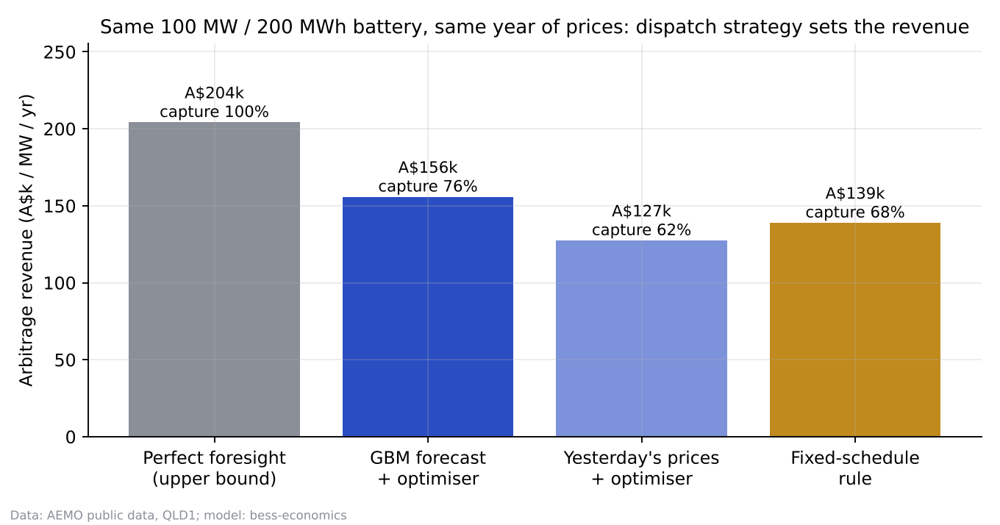

**Key findings**

1. **What dispatch skill is worth.** For the same 100 MW / 200 MWh battery, a GBM forecast feeding the MILP captures **76%** of the perfect-foresight revenue — 14 percentage points above re-using yesterday's prices and 8 points above a fixed charge/discharge schedule. Day-ahead forecast MAE is 41 A$/MWh (baseline 50); intraday rank correlation 0.85 (baseline 0.77). **Counter-intuitive result:** optimising against yesterday's prices (62%) does worse than a simple fixed-schedule rule (68%). The optimiser treats yesterday's noise as signal and over-trades; with a weak forecast, optimising can be worse than not optimising.
2. **Revenue is concentrated in a few days.** The top 5 days deliver **30%** of annual perfect-foresight revenue; the best day is 2025-01-22 — consistent with Modo Energy's finding that 22 January alone delivered 57% of Queensland battery revenue that month, an external check on the model. Being full and available on extreme-price days matters more than everyday small spreads.
3. **Market shape.** Prices are negative in **20%** of intervals (about 1,782 hours a year); the median daily 2-hour spread is **A$187/MWh**. Midday solar pushes prices below zero and the evening ramp sets the peak — this duck curve is where storage earns its money.
4. **More cycling is not more profit.** With a true degradation cost of A$30/MWh discharged, net revenue peaks when the dispatch model includes a wear cost of δ = 25 A$/MWh (179k A$/MW/yr at 676 cycles/yr) — 18% more than ignoring wear (δ = 0: 151k at 1377 cycles/yr), with half the cycles.
5. **Duration.** Revenue per MW for 1h / 2h / 4h is 128 / 204 / 303k A$/yr; revenue per MWh falls from 128k to 76k A$.
6. **Is merchant arbitrage alone investable?** Across 5,000 Monte Carlo runs, project IRR P10 / P50 / P90 = **1.6% / 4.8% / 8.4%**, with a 13% chance of clearing an 8% hurdle. A 7% IRR needs about **A$170k/MW** in year 1, while the GBM strategy realises about A$156k/MW. Energy arbitrage alone falls just short; the project needs FCAS revenue or a long-term capacity/tolling contract. For reference, Modo Energy reports an average NEM battery revenue of A$149k/MW/yr in 2024 (including FCAS).

<details><summary>More charts</summary>

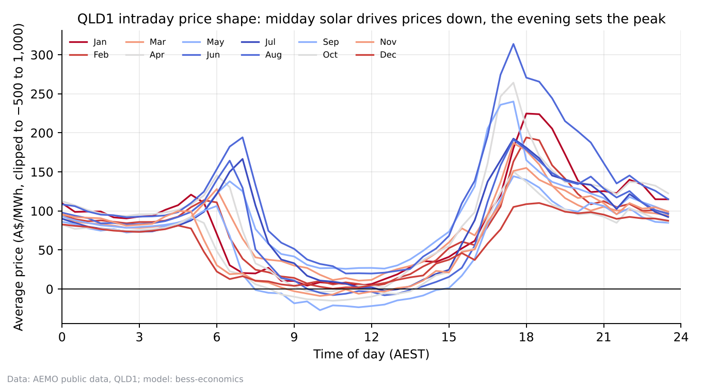
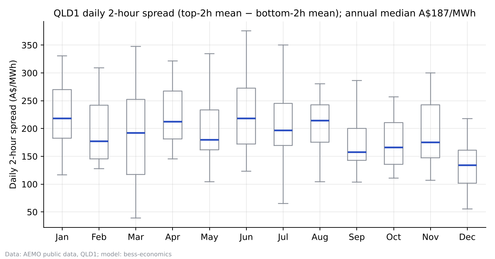
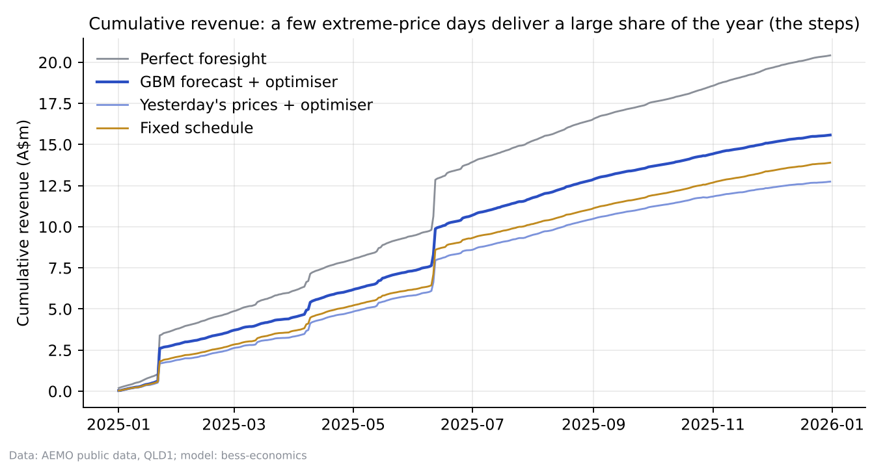
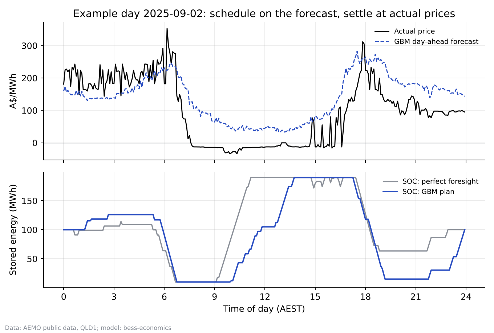
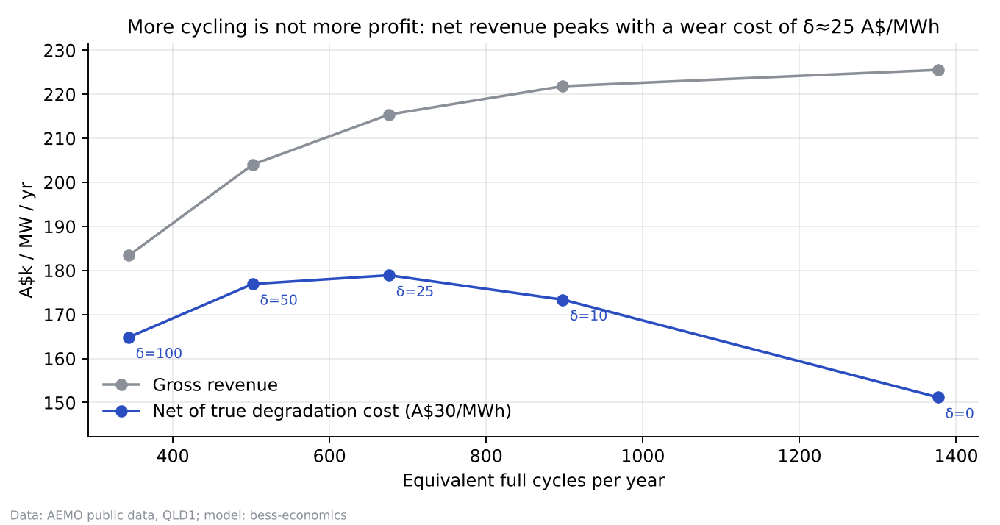
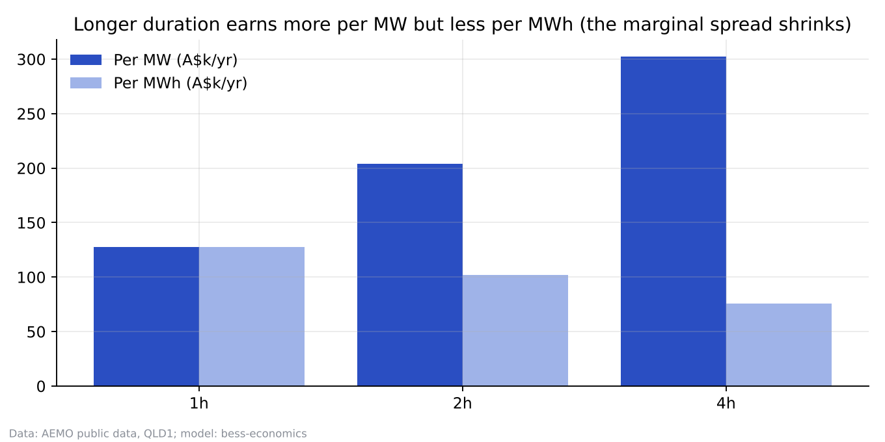
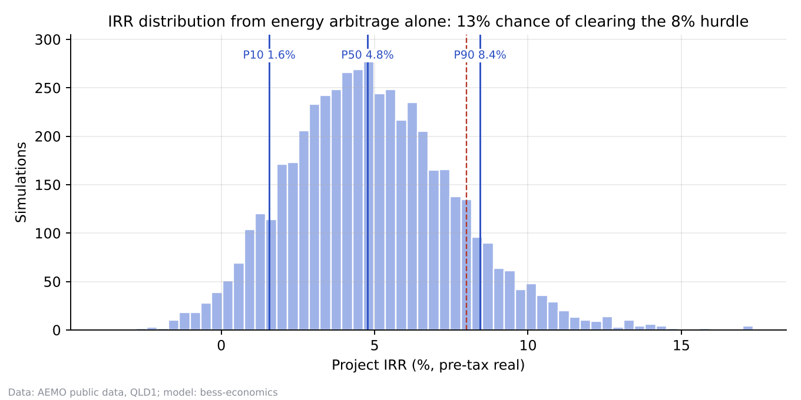

</details>

### Scenario experiments: change one parameter, see what moves

Same year of real prices and the same GBM forecast; only the battery parameters change. Capex uses a two-part estimate (A$560/kW power + A$240/kWh energy; mode A$520/kWh for 2h and A$380/kWh for 4h). Reproduce with `python run.py scenario --hours 4`.

| Scenario (100 MW) | Perfect foresight | GBM revenue | Capture | Cycles/yr | Net of cell wear | Capex (A$m) | IRR P50 (gross) | IRR P50 (lifetime) |
|---|---|---|---|---|---|---|---|---|
| Base: 2h / 1.5 cycles | 204 | 156 | 76% | 547 | 126 | 104 | 4.8% | 2.9% |
| 4h / cycle cap 1.5 | 303 | 245 | 81% | 542 | 186 | 152 | 6.2% | 3.1% |
| 2h / cycle cap 1 | 181 | 132 | 73% | 365 | 112 | 104 | 1.6% | 0.9% |
| 4h / cycle cap 1 | 281 | 226 | 81% | 365 | 187 | 152 | 4.6% | 3.1% |
| 2h / cycle cap 1.5 / RTE 90% | 207 | 160 | 77% | 547 | 131 | 104 | 5.3% | 3.6% |

Revenue in A$k/MW/yr. Net of cell wear = revenue − A$30 per MWh discharged. Gross IRR matches the Monte Carlo above (capacity fades a fixed 2% a year, extra cycling is free); lifetime IRR sets aside A$30 per MWh discharged to replace cells and keep capacity, so cycling has a cost — use this column when comparing cycle caps.

**Findings**

- **4h / cycle cap 1.5**: Revenue per MW rises 57% while capex rises only 46%, lifting gross IRR from 4.8% to 6.2%; capture rate also improves from 76% to 81%, as longer batteries are more forgiving of forecast error. But each cycle discharges twice the energy, so after cell wear the IRR moves only from 2.9% to 3.1% — most of the 4h advantage comes from higher throughput.
- **2h / cycle cap 1**: Cycles fall 33% but revenue only 15% (the trades cut are the low-spread ones). Net of cell wear, revenue is still 11% lower, so the extra half-cycle each day earns more than the A$30/MWh degradation cost. A one-cycle-per-day warranty cuts gross IRR on a 2h battery from 4.8% to 1.6% — the cycling clause is worth a lot.
- **4h / cycle cap 1**: With the same one-cycle cap, a 4h battery loses only 8% of gross revenue (245 → 226) and net revenue is unchanged (186 → 187), with lifetime IRR at 3.1% in both cases. One cycle already covers the evening peak, so the extra half-cycle only pays for its own wear: the warranty cap is nearly free for 4h but expensive for 2h.
- **2h / cycle cap 1.5 / RTE 90%**: Raising round-trip efficiency from 86% to 90% adds A$4.6k/MW/yr (+2.9%) to the forecast-driven strategy, lifting gross IRR from 4.8% to 5.3% (and from 2.9% to 3.6% after cell wear). Under perfect foresight the gain is only 1.6%: efficiency matters most for the marginal, low-spread trades a realistic strategy takes. As a rough estimate, the extra revenue over 15 years is worth about A$3m in present value for 100 MW (~3% of capex) — roughly the most a buyer should pay for the higher-efficiency system.

### China · 15-year cash-flow model for independent storage (Doc. 114 capacity price)

| Case (100 MW) | Capacity price (CNY/kW·yr) | Year-1 revenue (CNY m) | Project IRR (post-tax) | Equity IRR | Payback |
|---|---|---|---|---|---|
| Reference: no capacity price | 0.0 | 20.4 | 1.9% | -0.2% | 13.2 yrs |
| Shandong 2h | 82.5 | 27.8 | 7.4% | 13.4% | 8.8 yrs |
| Shandong 4h | 165.0 | 54.4 | 7.2% | 12.8% | 8.9 yrs |
| Gansu 2h | 165.0 | 30.5 | 9.4% | 18.9% | 7.5 yrs |
| Guangdong 2h | 100.0 | 30.0 | 8.8% | 17.3% | 8.1 yrs |

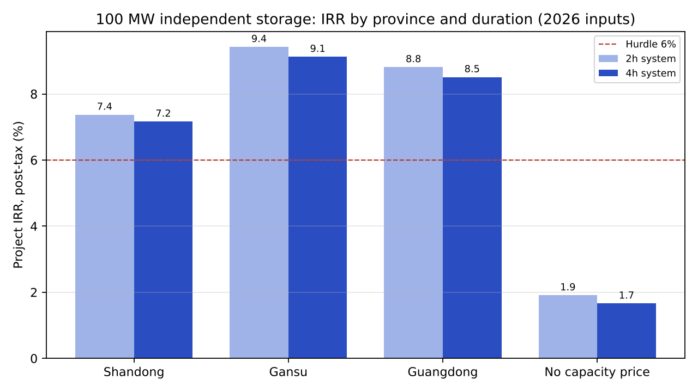

With arbitrage alone, project IRR is about 1.9%; adding the capacity price lifts a 2h project in Shandong to 7.4%. The tornado chart shows that three trading parameters — discharge spread, cycles per day and charging price — move IRR more than equipment capex, which ranks fourth.

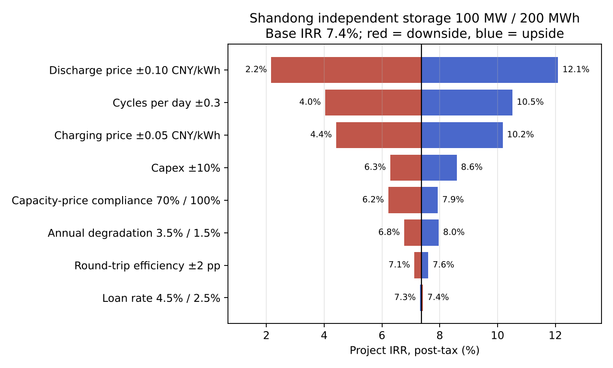

> Capacity-price basis: Gansu uses its published coal capacity-price benchmark of CNY 330/kW·yr. Shandong is estimated from the national coal benchmark of CNY 165/kW·yr, and Guangdong's CNY 200/kW·yr is an unconfirmed market figure; both should be updated once the provinces publish storage-specific rules (see `bess_econ/china_irr/presets.py`).

<!-- RESULTS:END -->

## Method

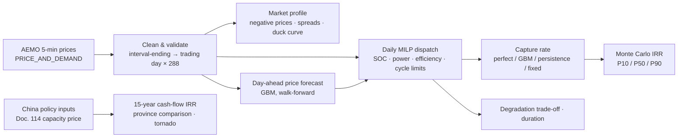

### Dispatch model (`bess_econ/dispatch.py`)

Each trading day has 288 five-minute intervals. Decision variables are charge power c<sub>t</sub>, discharge power d<sub>t</sub> and stored energy at the end of each interval s<sub>t</sub>:

- Energy balance: s<sub>t</sub> = s<sub>t−1</sub> + η·c<sub>t</sub>·Δt − d<sub>t</sub>·Δt / η, with η = √RTE
- Bounds: 0 ≤ c<sub>t</sub>, d<sub>t</sub> ≤ P; 5% ≤ SOC ≤ 95%; end-of-day SOC returns to its starting level (days are decoupled)
- Cycle limit: at most 1.5 equivalent full cycles per day (a common warranty term; can be switched off)
- Mutual exclusion: c<sub>t</sub> ≤ P·u<sub>t</sub>, d<sub>t</sub> ≤ P·(1 − u<sub>t</sub>), u<sub>t</sub> ∈ {0,1}. Without it, the LP relaxation charges and discharges at the same time during negative prices to burn energy through round-trip losses, which is not physically possible
- Objective: max Σ p<sub>t</sub>·(d<sub>t</sub> − c<sub>t</sub>)·Δt − δ·Σ d<sub>t</sub>·Δt, where δ is the degradation cost per MWh discharged

Solved with HiGHS (`scipy.optimize.milp`), about 0.1 s per day.

### Price forecast (`bess_econ/forecast.py`)

At the close of day D-1 the model forecasts all 288 intervals of day D, using only data from D-1 and earlier: same-interval lags at 1, 2 and 7 days, 7-day mean and median, previous-day statistics (mean, volatility, share of negative prices), lagged demand, and time-of-day and seasonal terms. The model is scikit-learn's `HistGradientBoostingRegressor`, with the training target clipped to [−500, 1000] A$/MWh (price spikes are not forecastable and only bias the fit), retrained monthly. A unit test checks that no feature uses future data.

### Investment returns (`bess_econ/montecarlo.py`, `bess_econ/china_irr/`)

- **Australia:** daily realised revenue from the GBM strategy → each simulated year resamples 365 days with replacement (keeping the randomness of spike events) × a lognormal market multiplier × annual spread compression × capacity fade. Capex follows a triangular distribution; output is a 15-year pre-tax real IRR.
- **China:** 15-year annual cash flow with four revenue streams (energy arbitrage, capacity price, ancillary services, capacity leasing), 70% debt, depreciation and the "3 years exempt, 3 years half-rate" tax holiday. Outputs project and equity IRR, LCOS, break-even revenue and a tornado sensitivity.

## Usage

```bash
pip install -r requirements.txt

# 1. Download Australian data (run on a machine that can reach aemo.com.au; default QLD1, Jan 2024 – Dec 2025, 24 files)
python scripts/download_aemo.py

# 2. Run the full pipeline (about 20 min on two cores, mostly 11 full-year MILP runs); results go to outputs/nem/
python run.py nem

# 3. Scenario experiments: change one or two battery parameters and compare revenue and IRR with the base case (2h / 1.5 cycles), 3–5 min each
python run.py scenario --hours 4
python run.py scenario --max-cycles 1.0 --note "your finding in one sentence"
python run.py scenario --rte 0.90 --capex 400 500 620

# 4. China IRR model
python run.py china all
python run.py china evaluate --preset shandong --hours 2 --set rte=0.88

# 5. Refresh the results sections of both READMEs (including the scenario table)
python scripts/update_readme.py

# Tests (18 cases: timestamp convention, gaps and duplicates, energy conservation, mutual exclusion, no data leakage, IRR values, etc.)
python -m pytest -q

# Without real data, check the pipeline on synthetic data (results are not meaningful)
python run.py nem --demo
```

## Key assumptions and sources

| Parameter | Value | Source |
|---|---|---|
| Battery | 100 MW / 200 MWh, RTE 86%, SOC 5–95%, ≤1.5 cycles/day | Typical industry specification (assumption) |
| True degradation cost | A$30/MWh discharged | Cell replacement cost ÷ cycle life (assumption) |
| Australian 2h storage capex | Triangular A$420 / 520 / 650 per kWh | CSIRO GenCost 2024-25 draft: A$423/kWh for 4h; the 2025-26 final report cites a further 11–16% fall in storage costs; Origin's Eraring stage 1 (460 MW / 920 MWh) about A$652/kWh (RenewEconomy, Dec 2024) |
| Fixed O&M | 1.5% of capex per year | Assumption |
| Spread compression / market volatility | 3% a year; log standard deviation 0.30 | Assumption, adjustable |
| NEM battery revenue benchmark | 2024 average A$149k/MW/yr (including FCAS) | Modo Energy, Feb 2025 |
| China inputs | System tender prices, capacity-price formula and provincial benchmarks, industry IRR ranges | See comments in `bess_econ/china_irr/presets.py` |

## Limitations

- **Energy arbitrage only.** FCAS (frequency control ancillary services) revenue is not modelled. FCAS is a meaningful share of actual NEM battery revenue, so the Australian results are conservative.
- **Price-taker assumption.** The battery does not move prices. As more storage connects, spreads compress; the Monte Carlo approximates this with annual compression.
- **Day-ahead schedule with no intraday re-optimisation.** Real operators re-dispatch on 5-minute pre-dispatch information, so the GBM capture rate is a conservative lower bound.
- No network constraints, marginal loss factors (MLF) or connection charges. The China model is annual and has no interval-level dispatch.

## Roadmap

- [ ] Co-optimise energy and FCAS
- [ ] Intraday rolling re-optimisation (re-plan the remaining intervals every 30 minutes with the latest information)
- [ ] Rainflow-counting degradation model to replace the linear throughput cost
- [ ] Re-run on Chinese provincial spot prices for an Australia–China comparison

## Author

Yiming Ma (马一鸣) · BE (Hons) Mechatronic Engineering, University of Queensland · Master of Sustainable Energy candidate · [GitHub](https://github.com/StevenMa-creater)
