# BESS Economics：储能电站收益、调度与投资回报

**English summary** — An open-source toolkit for grid-scale battery storage economics, built on real market data. It loads 5-minute AEMO NEM prices, solves a mixed-integer dispatch optimisation for every trading day, forecasts next-day prices with gradient-boosted trees in a strict walk-forward setup, measures how much of the perfect-foresight revenue a realistic strategy captures, quantifies the cycling-vs-degradation trade-off, and turns realised revenue into a Monte Carlo IRR distribution. A second module models Chinese independent storage under the 2026 capacity-price policy (NDRC Document No. 114).

一个基于真实市场数据的储能电站经济性工具。回答三个问题：

1. **一块电池在真实电价下最多能赚多少钱？** 用 5 分钟电价逐日求解混合整数规划（MILP），得到收益理论上限。
2. **现实中能拿到上限的多少？** 次日电价预测（梯度提升树，按月滚动训练、零未来数据泄漏）→ 按预测做计划 → 按真实电价结算，算出"收益捕获率"。
3. **这个收益够不够收回投资？** 把可实现收益接入 15 年现金流，用蒙特卡洛模拟出 IRR 分布；中国市场单独建模 114 号文容量电价。

## 一分钟看结论

<!-- RESULTS:START -->
### 澳洲 NEM · QLD1 · 2025 年回测（365 天，5 分钟电价）

| 策略 | 年套利收入（A$ 千/MW） | 收益捕获率 | 年等效循环 |
|---|---|---|---|
| 完美预知（上限） | 204 | 100% | 547 |
| GBM 预测 + 优化 | 156 | 76% | 547 |
| 昨日电价 + 优化 | 127 | 62% | 547 |
| 固定时段规则 | 139 | 68% | 338 |

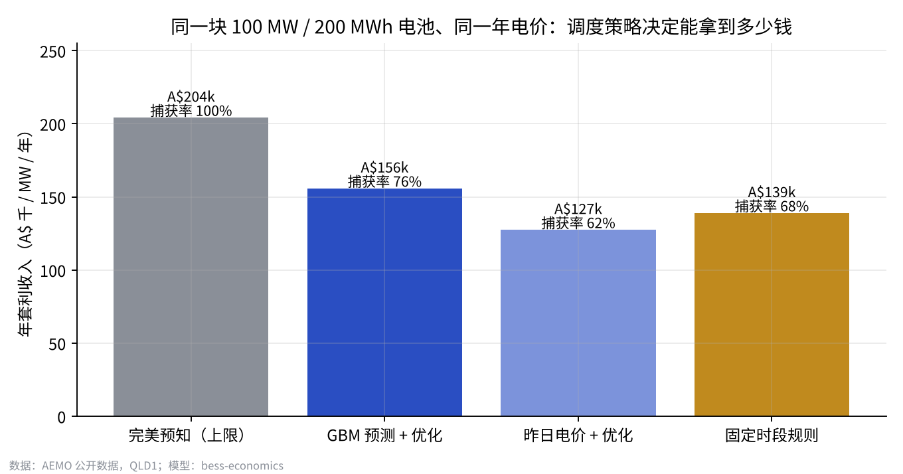

**结论**

1. **调度能力值多少钱**：同一块 100 MW / 200 MWh 电池，GBM 预测 + MILP 优化拿到完美预知上限的 **76%**，比"照抄昨天电价"高 14%（百分点），比固定时段规则高 8%。次日电价预测 MAE 41 A$/MWh（基准 50），日内排序相关性 0.85（基准 0.77）。**反直觉的一点**：用昨天电价做优化（62%）反而不如固定时段规则（68%），因为优化器会把昨天的随机波动当成信号、过度交易；预测质量不够时，"优化"可能比不优化更差。
2. **收益高度集中**：全年收益最高的 5 天贡献了完美预知收入的 **30%**，最高的一天是 2025-01-22（与 Modo Energy 报告的"1 月 22 日一天占昆州电池当月收入 57%"一致，可作为模型的外部验证）。能否在极端价格日满电待命，比日常的小价差更重要。
3. **市场形态**：负电价占全年 **20%** 的时段（约 1,782 小时），每日 2 小时价差中位数 **A$187/MWh**；午间光伏把电价压到负值、傍晚形成高峰，这是储能套利的来源。
4. **多循环不等于多赚钱**：按真实衰减成本 30 A$/MWh 计，调度时计入 δ = 25 A$/MWh 时净收益最高（179 千 A$/MW/年，676 次/年），比不计衰减（δ = 0，151 千、1377 次/年）多 18%，循环次数减半。
5. **时长**：1h / 2h / 4h 每 MW 年收入 128 / 204 / 303 千 A$，每 MWh 收入递减（128 → 76 千 A$）。
6. **只靠能量套利能不能投**：蒙特卡洛 5,000 次，项目 IRR P10 / P50 / P90 = **1.6% / 4.8% / 8.4%**，超过 8% 门槛的概率 13%；达到 7% IRR 需要第 1 年约 **A$170 千/MW** 收入。GBM 策略实际可实现约 A$156 千/MW，略低于这条线，所以只靠能量套利不足以支撑投资，需要 FCAS 或长期容量合同补足。作为对照，Modo Energy 统计 2024 年 NEM 电池平均总收入（含 FCAS）为 A$149 千/MW/年。

<details><summary>更多图表</summary>

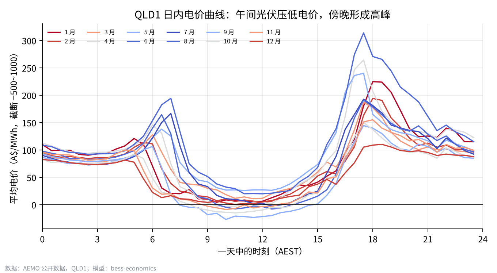
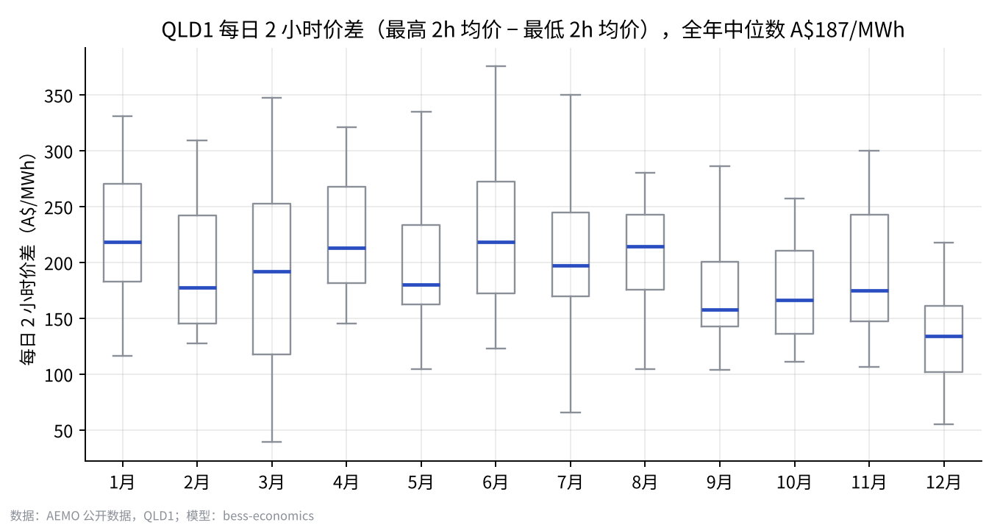
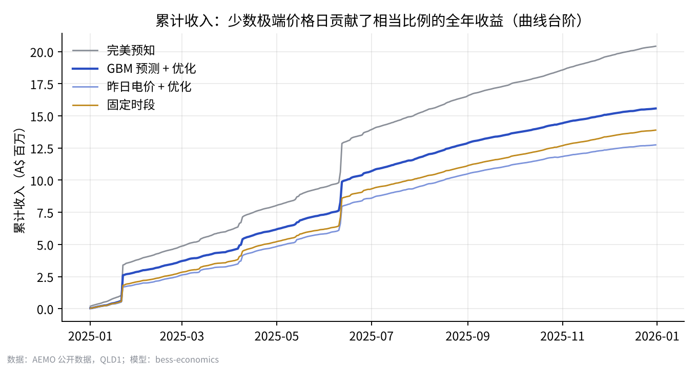
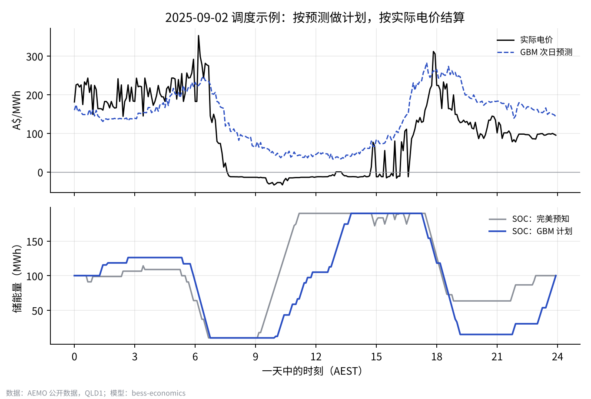
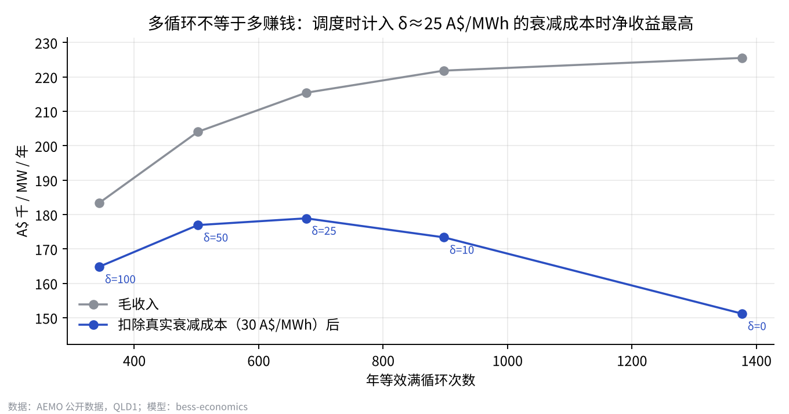
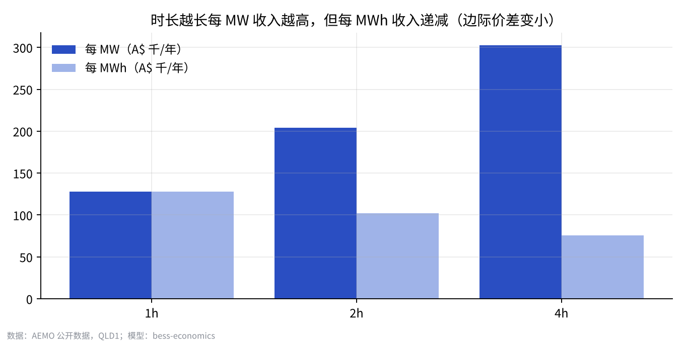
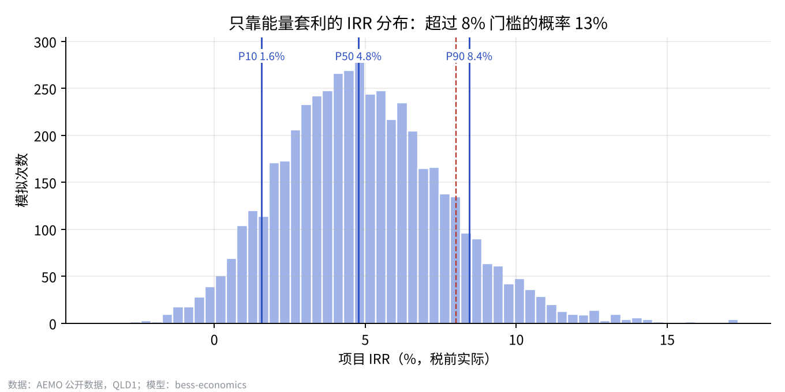

</details>

### 情景实验：只改一个参数，结论怎么变

同一年真实电价、同一个 GBM 预测，只改电池参数；投资成本按"功率部分 560 A$/kW + 电池部分 240 A$/kWh"两段式估算（2h 众数 520、4h 众数 380 A$/kWh）。复现：`python run.py scenario --hours 4`。

| 情景（100 MW） | 完美预知 | GBM 收入 | 捕获率 | 年循环 | 扣衰减净收入 | 投资（百万 A$） | IRR P50（毛收入） | IRR P50（全寿命） |
|---|---|---|---|---|---|---|---|---|
| 基准：2h / 1.5 循环 | 204 | 156 | 76% | 547 | 126 | 104 | 4.8% | 2.9% |
| 4h / 循环上限 1.5 | 303 | 245 | 81% | 542 | 186 | 152 | 6.2% | 3.1% |
| 2h / 循环上限 1 | 181 | 132 | 73% | 365 | 112 | 104 | 1.6% | 0.9% |
| 4h / 循环上限 1 | 281 | 226 | 81% | 365 | 187 | 152 | 4.6% | 3.1% |
| 2h / 循环上限 1.5 / RTE 90% | 207 | 160 | 77% | 547 | 131 | 104 | 5.3% | 3.6% |

收入单位：千 A$/MW/年。扣衰减净收入 = 收入 − 每放 1 MWh × 30 A$ 电芯损耗。IRR 毛收入口径与上文蒙特卡洛一致（容量每年固定衰减 2%，多循环不计成本）；全寿命口径按每 MWh 放电计提 30 A$ 补充电芯、容量保持，循环成本随放电量增加，比较循环上限时应看这一列。

**我的发现**

- **4h / 循环上限 1.5**：每 MW 收入多 57%，投资只多 46%，毛收入 IRR 从 4.8% 升到 6.2%；捕获率也从 76% 升到 81%，时长越长对预测误差越宽容。但每次循环放电量翻倍，计入电芯损耗后 IRR 只从 2.9% 到 3.1%，4h 的优势大部分来自更大的吞吐量。
- **2h / 循环上限 1**：循环少了 33%，收入只少 15%（砍掉的是价差较小的交易），但扣掉电芯损耗后净收入仍少 11%，说明每天第二个半次循环的价差高于 30 A$/MWh 的衰减成本。质保把 2h 电池限制在每天 1 次，毛收入 IRR 从 4.8% 掉到 1.6%，循环次数条款很值钱。
- **4h / 循环上限 1**：同样限到每天 1 次，4h 电池毛收入只少 8%（245 → 226），扣衰减净收入几乎不变（186 → 187），全寿命 IRR 都是 3.1%。4h 电池一次循环就能吃满傍晚高峰，多出的半次循环只够覆盖损耗，所以每天 1 次的质保对 4h 几乎没有代价，对 2h 却很贵。
- **2h / 循环上限 1.5 / RTE 90%**：我试过把效率从 86% 提到 90%，发现每 MW 每年多赚 __ 千澳元，IRR 从 4.8% 升到 __%，说明……

### 中国 · 独立储能 15 年现金流模型（114 号文容量电价）

| 场景（100 MW） | 容量电价（元/kW·年） | 第 1 年收入（万元） | 全投资税后 IRR | 资本金 IRR | 回收期 |
|---|---|---|---|---|---|
| 对照：无容量电价 | 0.0 | 2,039 | 1.9% | -0.2% | 13.2 年 |
| 山东 2h | 82.5 | 2,782 | 7.4% | 13.4% | 8.8 年 |
| 山东 4h | 165.0 | 5,444 | 7.2% | 12.8% | 8.9 年 |
| 甘肃 2h | 165.0 | 3,054 | 9.4% | 18.9% | 7.5 年 |
| 广东 2h | 100.0 | 2,995 | 8.8% | 17.3% | 8.1 年 |

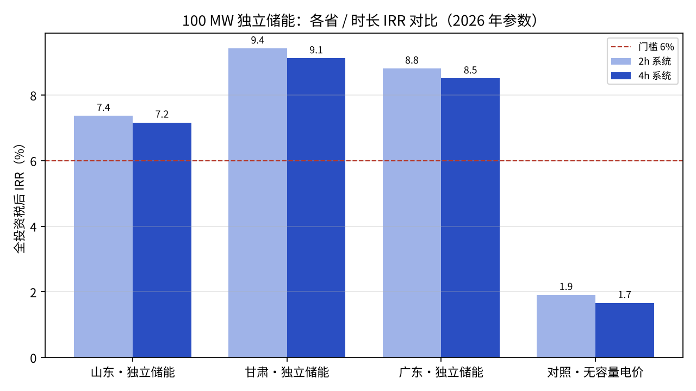

没有容量电价时只靠套利 IRR 约 1.9%，山东 2h 加容量电价后 7.4%；龙卷风敏感性分析显示放电价差、循环次数、充电价格三个交易参数对 IRR 的影响最大，设备投资排第四。

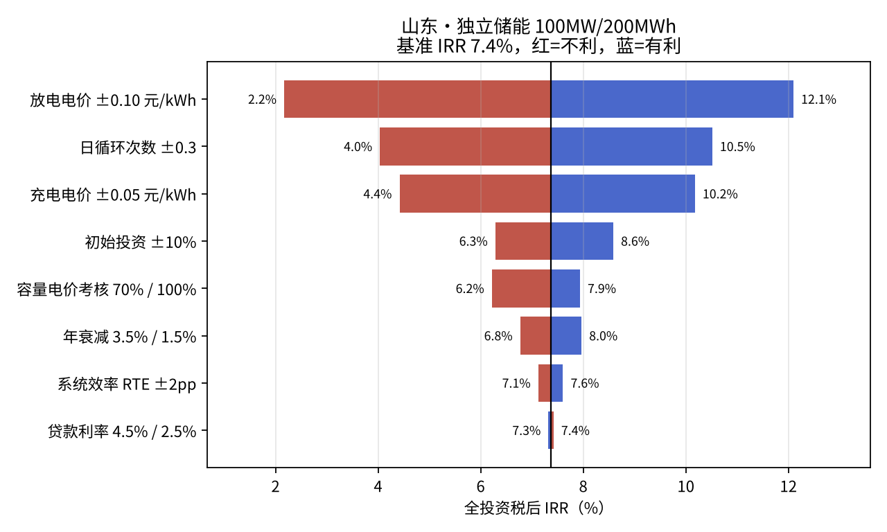

<!-- RESULTS:END -->

## 方法

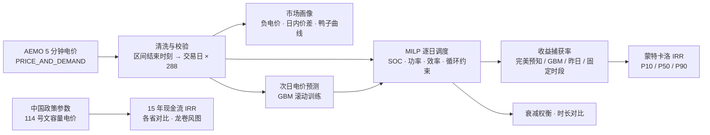

### 调度模型（`bess_econ/dispatch.py`）

每个交易日 288 个 5 分钟区间，决策变量为充电功率 c<sub>t</sub>、放电功率 d<sub>t</sub>、区间末储能量 s<sub>t</sub>：

- 储能平衡：s<sub>t</sub> = s<sub>t−1</sub> + η·c<sub>t</sub>·Δt − d<sub>t</sub>·Δt / η，η = √RTE
- 边界：0 ≤ c<sub>t</sub>, d<sub>t</sub> ≤ P；5% ≤ SOC ≤ 95%；日末 SOC 回到日初（日与日解耦）
- 循环上限：每日等效满循环 ≤ 1.5（质保常见约束，可关）
- 互斥：c<sub>t</sub> ≤ P·u<sub>t</sub>，d<sub>t</sub> ≤ P·(1 − u<sub>t</sub>)，u<sub>t</sub> ∈ {0,1}。不加互斥时，负电价下线性规划会利用往返损耗"空耗"电量套利，物理上不成立
- 目标：max Σ p<sub>t</sub>·(d<sub>t</sub> − c<sub>t</sub>)·Δt − δ·Σ d<sub>t</sub>·Δt，δ 为单位放电量的衰减成本

求解器 HiGHS（scipy.optimize.milp），每日约 0.1 秒。

### 电价预测（`bess_econ/forecast.py`）

D-1 日收盘时预测 D 日 288 个区间，特征只用 D-1 及更早数据：同时段 1/2/7 日滞后、7 日均值与中位数、前一日统计量（均值、波动、负电价占比）、滞后负荷、日内与年内周期变量。模型为 scikit-learn `HistGradientBoostingRegressor`，训练目标截断在 [−500, 1000] A$/MWh（尖峰不可预测，留在目标里只会拉偏模型），按月滚动重训。单元测试专门检查特征无未来数据泄漏。

### 投资回报（`bess_econ/montecarlo.py`、`bess_econ/china_irr/`）

- **澳洲**：GBM 策略的逐日真实可实现收益 → 每年有放回抽样 365 天（保留尖峰事件的偶然性）× 市场乘数（对数正态）× 价差逐年压缩 × 容量衰减，投资成本按三角分布，15 年税前实际 IRR。
- **中国**：15 年年度现金流，四类收益（电能量套利、容量电价、辅助服务、容量租赁），70% 贷款、折旧、三免三减半，输出全投资 / 资本金 IRR、LCOS、盈亏平衡收入和龙卷风敏感性。

## 用法

```bash
pip install -r requirements.txt

# 1. 下载澳洲数据（在能访问 aemo.com.au 的电脑上运行；默认 QLD1，2024-01 至 2025-12，24 个文件）
python scripts/download_aemo.py

# 2. 跑全流程（双核约 20 分钟，主要花在 11 次全年 MILP），结果在 outputs/nem/
python run.py nem

# 3. 情景实验：改一两个电池参数，和基准（2h / 1.5 循环）对比收益和 IRR，每个约 3–5 分钟
python run.py scenario --hours 4
python run.py scenario --max-cycles 1.0 --note "一句话写下你的发现"
python run.py scenario --rte 0.90 --capex 400 500 620

# 4. 中国 IRR 模型
python run.py china all
python run.py china evaluate --preset shandong --hours 2 --set rte=0.88

# 5. 根据结果刷新 README 的结论区块（含情景实验表）
python scripts/update_readme.py

# 测试（18 个用例：时间戳约定、缺口与重复处理、能量守恒、互斥、无数据泄漏、IRR 数值等）
python -m pytest -q

# 没有真实数据时，用合成数据验证流程（结论无效）
python run.py nem --demo
```

## 关键假设与来源

| 参数 | 取值 | 来源 |
|---|---|---|
| 电池 | 100 MW / 200 MWh，RTE 86%，SOC 5–95%，≤1.5 循环/天 | 行业常见规格（假设） |
| 真实衰减成本 | 30 A$/MWh 放电量 | 按电芯更换成本 ÷ 循环寿命估算（假设） |
| 澳洲 2h 储能投资 | 三角分布 A$420 / 520 / 650 每 kWh | CSIRO GenCost 2024-25 草案 4h 为 A$423/kWh，2025-26 终版称储能成本再降 11–16%；Origin Eraring 一期 460 MW/920 MWh 约 A$652/kWh（RenewEconomy 2024-12） |
| 年固定运维 | 投资 × 1.5% | 假设 |
| 价差逐年压缩 / 市场波动 | 3% / 年；对数标准差 0.30 | 假设，可调 |
| NEM 电池收入基准 | 2024 年平均 A$149 千/MW/年（含 FCAS） | Modo Energy 2025-02 |
| 中国参数 | 系统中标价、容量电价公式与各省标准、行业 IRR 区间 | 见 `bess_econ/china_irr/presets.py` 注释 |

## 局限

- **只模拟能量套利**，没有 FCAS（调频）收益；NEM 电池实际收入中 FCAS 占相当比例，所以本模型对澳洲项目偏保守。
- **价格接受者假设**：电池不影响电价；大规模储能并网后价差会被压缩（蒙特卡洛中用逐年压缩近似）。
- **次日计划、不做日内修正**：真实运营会在 5 分钟预调度信息下滚动修正，GBM 捕获率是保守下限。
- 不含网络约束、边际损耗系数（MLF）和并网费用；中国模型是年度口径，没有逐时调度。

## 下一步

- [ ] 加入 FCAS 联合优化（能量 + 调频共同出清）
- [ ] 日内滚动优化（每 30 分钟用最新信息重排剩余区间）
- [ ] 雨流计数法电池衰减模型，替代线性吞吐量成本
- [ ] 换山东现货数据重跑，做中澳对比

## 作者

马一鸣（Yiming Ma）· 昆士兰大学 机电工程学士（Hons）、可持续能源硕士在读 · [GitHub](https://github.com/StevenMa-creater)
